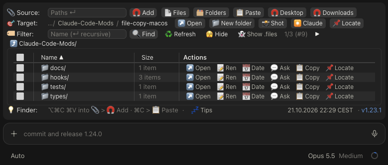
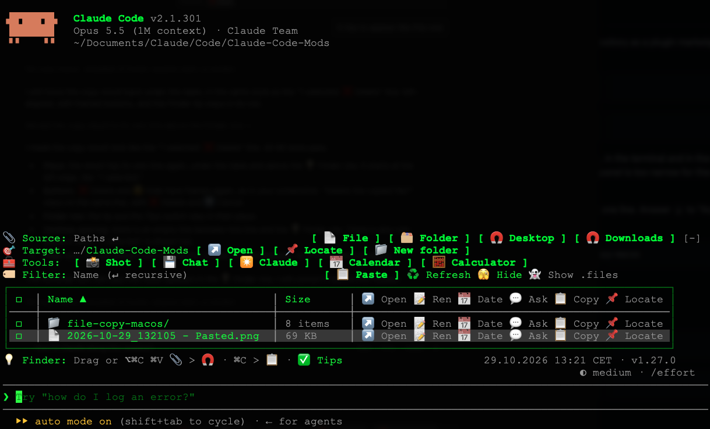

# file-copy-macos

A [Claude Code](https://claude.com/claude-code) mod for macOS. It adds a bar above the prompt where you can copy files and folders from anywhere on your Mac into your project. After each change, Claude gets a short note about it.

**Claude Code desktop app**



**Claude Code in a terminal**



## Install

Run these two commands in a terminal. The first adds this GitHub repository as a plugin marketplace, the second installs the mod for your user (all projects):

```bash
claude plugin marketplace add olafrv/file-copy-macos
```

```bash
claude plugin install file-copy-macos@file-copy-macos
```

The bar appears in every Claude Code session started after the install, in the terminal and in the Code tab of the Claude desktop app. It does not appear in the VS Code extension (its panel is too narrow for the bar) or in the mobile app.

You can also install it from inside a Claude Code terminal session with one line. Answer `y` to "Add marketplace?", then press Enter:

```
/plugin install file-copy-macos --marketplace olafrv/file-copy-macos
```

### Update

Get the newest version, then reload the mods in an open session:

```bash
claude plugin update file-copy-macos
```

```
/reload-plugins
```

### Uninstall

```bash
claude plugin uninstall file-copy-macos
```

## Settings

The mod has one setting, **Search: skip folders**: the folder names that 🔍 Find never searches (comma-separated). The default is `.git, .svn, .hg, node_modules, bower_components`.

- **In a terminal:** run `claude`, type `/config` and change "Search: skip folders".
- **In Claude Desktop:** the Code tab has no screen for plugin settings. Use a terminal as above (the setting is shared with the desktop app), or add this to `~/.claude/settings.json`:

  ```json
  "pluginConfigs": {
    "file-copy-macos": {
      "options": { "searchSkip": ".git, .svn, .hg, node_modules, bower_components, .venv" }
    }
  }
  ```

A change applies after `/reload-plugins` or in a new session.

## Requirements

- macOS 15 or later.
- In a terminal: a window of at least 80 columns and 35 rows. In a shorter window the bar gets too few rows (Claude Code gives it at most half of the window, together with the prompt), so it scrolls and hides the file list. The desktop app needs nothing special.
- Claude Code with mod (function hook) support.

The mod is for macOS only, because it uses these macOS commands:

| Command | Used for |
| --- | --- |
| `/bin/sh` with `cp -R` | Copying into the project, and the "name 2" rule for Keep both |
| `/bin/mv` | 📝 Ren and 📅 Date |
| `/bin/mkdir` | 📁 New folder |
| `/usr/bin/trash` (macOS 15 and later) | ❌ Delete and 🔁 Overwrite, which move items to the Trash |
| `/usr/bin/open` | ↗️ Open and 📌 Locate |
| `/usr/sbin/screencapture` | 📸 Shot |
| `/usr/bin/osascript` | 📄 Files and 🗂️ Folders pickers, 📋 Copy and 📋 Paste (clipboard files and images), ✴️ Claude (Terminal) |
| `/bin/date` | The time zone of the clock |
| `/usr/bin/git` (optional) | 🔍 Find in git projects. Without git, the mod searches the folders itself |

Listing folders, file sizes, name checks, 🧲 Desktop, 🧲 Downloads and the search outside git use Claude Code's own file access, not commands.

## What it does

The rows of the bar are 📎 Source, 🎯 Target, 🏷️ Filter (the target's content) and 💡 Finder. In a terminal narrower than 100 columns (the standard size is 80×24), the rows and most buttons show only their icons, to leave room for the fields: 📄 Files, 🗂️ Folders, 📋 Paste, ✴️ Claude, 📸 Shot, 🧲🖥️ Desktop, 🧲⬇️ Downloads, ♻️ Refresh, 🫣 Hide, 📁 New folder, 👻 .files. The 💡 tip then reads `Drag/⌥⌘C ⌘V > 📎 🧲 Add · ⌘C > 📋`.

**💤 Tips** in the 💡 Finder row turns on help tips (it becomes **✅ Tips**). Then point at 📋 Paste, 🧲 Desktop, 🧲 Downloads or the 💡 Finder tip to see what it does. The other buttons say it in their label. Tips are off by default, because the app shows them at once, without a delay. The mod remembers your choice. In the terminal, tips need a terminal that reports mouse movement, which fullscreen mode usually does.

### Copy files and folders

- **Paste paths** into the field and press Enter (or **🧲 Add**). In Finder, Option+Cmd+C copies the paths of the selected items. In a terminal you can also drag files into the field.
- **📄 Files** and **🗂️ Folders** open the macOS picker. You can select several items: hold Cmd and click each one.
- **📋 Paste** adds the files and folders you copied in Finder with Cmd+C. With no files on the clipboard, it saves a copied image (for example a screenshot taken with Ctrl+Cmd+Shift+4, or "Copy Image" in a browser) into the target as a PNG, named by the local time, for example `2026-10-21_194512 - Pasted.png`. Text on the clipboard is ignored.
- **🧲 Desktop** copies the newest file or folder on your Desktop, for example the screenshot you just took.
- **🧲 Downloads** copies the newest file or folder in `~/Downloads`. Downloads still in progress are skipped.
- Before you press Enter, the list under the field shows each pasted item. Click an item to remove it. Its path is also removed from the field.
- Folders are copied with all their contents.

### Name conflicts

If a name already exists in the target, the mod asks first:

| Button | Result |
| --- | --- |
| 🔁 Overwrite | The old item goes to the Trash, the new one takes its place. |
| 👯 Keep both | The new item is saved as "name 2.ext". |
| ⏭️ Copy only new | Items with a conflict are not copied. The others are. |
| ⏹️ Cancel | Nothing is copied. |

### Target and content

- **🎯 Target** is the project root at the start. Each folder of its path is a button: a click makes that folder the target. The path starts at the project folder (`…/my-project/docs`); point at it to see the full path. If it is still too long, the folders in the middle become "…". **↗️ Open** opens the target folder in Finder.
- **📁 New folder** creates a folder in the target and opens it.
- **📸 Shot** takes a screenshot straight into the target: drag an area, or press Space and click a window; Esc cancels. The image is named by the local time, for example `2026-10-16_173756 - Screenshot.png`. It needs the macOS **Screen Recording** permission (System Settings > Privacy & Security > Screen & System Audio Recording) for the app that runs Claude Code: for the desktop app the entry **Claude** ("Claude Desktop" alone may not be enough), for a terminal session your terminal app. Quit and reopen the app after turning it on. Without it, a toast says the screenshot could not be taken.
- **✴️ Claude** opens a new Terminal window of 110 columns and 35 rows (so the bar has room) in the target and starts Claude Code there (it looks for the `claude` program in the usual install folders; if there is none, a toast says so). It always uses the Terminal app, also from the desktop app. The first time, macOS asks whether Claude (or your terminal app) may control Terminal: allow it. To change it later: System Settings > Privacy & Security > Automation.
- **📌 Locate** shows the target folder in its parent folder, selected.
- **🏷️ Filter:** is always shown. While you type, it shows only the items of the target folder whose name contains the text (case is ignored). Typing in it opens the list. **🧹 Clear** removes the filter, and so does **🫣 Hide**.
- **🔍 Find** (or Enter) searches the target folder and all folders below it. The table then gets a **Folder** column with each item's folder. Point at a folder there to see its full path; a click opens it. All actions work on the items found, and 📝 Ren keeps an item in its own folder. Typing in the filter again, 🧹 Clear or opening a folder ends the search.
  - In a git project, the search follows `.gitignore`: ignored files are not found. To skip a folder only on your Mac, add it to `.git/info/exclude`.
  - The setting **Search: skip folders** (see [Settings](#settings)) lists folder names the search always skips. The default is `.git, .svn, .hg, node_modules, bower_components`. Add others, for example `.venv` or `dist`.
  - The search shows at most 500 results and stops after 5 seconds. If it hits a limit, a yellow warning says so.
  - Skipped and ignored items are still in the table when you open their folder.
- **♻️ Refresh** reads the list again, for changes made outside the bar (for example in Finder). During a search it runs the search again.
- The content of the target shows when a session starts; **🫣 Hide** closes it and **👁️ Show** opens it again.
- Names that start with "." (for example `.env` or `.claude`) are hidden, as in Finder. **👻 Show .files** shows them, in the list and in search results; **👻 Hide .files** hides them again. The mod remembers your choice.
- The content is a framed table with the columns tick box, Name, Size and Actions. Every other row is striped in a faint gray; on the desktop the row under the pointer also lights up. Long names are cut with "…". Lines separate the columns and the header. For a folder, Size shows its number of items, as Finder counts them (only the first level, and names starting with "." only while 👻 .files is on): for example `3 items`, `1 item` or `Empty`. Search results show no count.
- Click a 📁 folder name to open it. It becomes the target. ⤴️ goes up one level. You cannot leave the project.
- Click a 📄 file name to open it with its default macOS app.
- Click **Name** or **Size** (and **Folder** during a search) in the header to sort by that column. Click again to change between ascending (▲) and descending (▼). Folders always come first; when sorting by size, they stay in name order.
- The list shows 4 to 10 items per page: as many as fit, so the bar does not need to scroll. In a larger terminal window you see more items. The desktop app gives the bar less room, so it usually shows 4. Use **◀** and **▶** at the end of the 🏷️ Filter row to change the page; "2/3 (#9)" means page 2 of 3, 9 items. Ticked items stay ticked on other pages.
- Each row has six actions:
  - **↗️ Open:** opens a file in its default macOS app, a folder in Finder.
  - **📝 Ren:** renames the item.
  - **📅 Date:** opens the rename field with the time of the click before the name, as a click on the clock copies it: `report.pdf` becomes `2026-10-21_221537 - report.pdf`. Press Enter to rename, or ⏹️ Cancel. A date the name already has is replaced by the new one.
  - **💬 Ask:** see below.
  - **📋 Copy:** puts the item on the clipboard as a file. Press Cmd+V in Finder, on the Desktop, in Mail or in Slack to paste it.
  - **📌 Locate:** opens Finder at the item's folder with the item selected. From there you can drag it.
- **💬 Ask** puts `@path` (relative to the project) at the cursor in the prompt, so you can ask Claude about the item. A path with a space is quoted: `@"docs/My File.pdf"`.
- Tick files or folders (☐, on the desktop ⬜). The tick box in the header ticks all items that match the filter, on all pages; a second click unticks them.
- With items ticked, a row under the table offers:
  - **❌ Delete:** moves them to the Trash. A folder goes to the Trash with all its contents.
  - **📅 Date:** asks first, then puts the same time before all their names. Names that already start with such a date stay as they are, and an item is never overwritten.
  - **💬 Ask:** puts all of them into the prompt.
  - **📋 Copy:** puts them on the clipboard as files. Press Cmd+V in Finder, on the Desktop, in Mail or in Slack to paste them. This replaces drag and drop, which the mod cannot offer.

### Clock

The Finder row shows the local date, time and time zone, for example `13.10.2026 14:32 CEST`. It changes on each full minute. Click it to copy the date and time as the start of a file name, `2026-10-13_143215 - `, so you can paste it and type the name after it. The mod reads the time zone from macOS and checks it again each hour, so the change to and from summer time is shown. The version of the mod follows the clock after a middle dot. On the desktop it is a link to this README.

### What Claude is told

After each copy, delete, rename or new folder, the mod adds a short note to the conversation, for example:

> FYI from the file-copy-macos mod: the user copied 1 file(s) into the folder /Users/me/Projects/my-app/docs:
> - report.pdf
>
> This is information only. Do not open, read or change these files and do not reply to this note. Wait for the next request from the user.

The note does not start a turn. Claude reads it with your next message and does not act on it unless you ask.

## Safety

- **Nothing is deleted outright.** Delete and Overwrite move items to the macOS Trash, so you can restore them.
- **Every delete asks first.** Overwrite asks in its own question.
- **Rename never overwrites.** A name that exists is refused.
- **Files stay inside the project.** The target cannot go above the project root, and folder names with `..` are refused.
- **Everything stays on your Mac.** The mod copies files on disk and sends nothing to a server. It never attaches files to the prompt by itself; 💬 Ask only writes `@path` into it, and you decide whether to send.

## Limits

- **No drag and drop.** The mod API has no drag events, in either direction. To bring files in, use **📋 Paste** (after Cmd+C in Finder), pasted paths (Option+Cmd+C), the pickers, or **🧲 Desktop** and **🧲 Downloads**. To take files out, use **📋 Copy** or **📌 Locate**.
- **Buttons use the app's own style.** A mod cannot change their color or font size.
- **Folder sizes are not shown.** Reading every file in a big folder would be slow.
- **The search finds names, not file contents.** It does not look inside files.

## Development

### Load the mod from your clone in every session

This is the setup for working on the mod. The mod loads from your clone in every new session, in the terminal and in the desktop app, and reloads by itself when you save a file.

Add this to `~/.claude/settings.json`, with the absolute path of your clone:

```json
{
  "env": {
    "CLAUDE_CODE_PLUGIN_DIRS": "/path/to/file-copy-macos",
    "CLAUDE_CODE_PLUGIN_DIR_WATCH": "1"
  }
}
```

- `CLAUDE_CODE_PLUGIN_DIRS` loads the mod from that folder in every new session.
- `CLAUDE_CODE_PLUGIN_DIR_WATCH` makes desktop app sessions reload the mod when a file changes. Terminal sessions do this without it.
- The setting is read when a session starts, so start a new session after you add it.

**Keep one copy only.** Do not also install the mod with `claude plugin install` while this setting is active, or you will see two bars. Make all changes in the clone.

Clone the repository with:

```bash
git clone git@github.com:olafrv/file-copy-macos.git
```

The clone folder is `file-copy-macos`. Use its absolute path in `CLAUDE_CODE_PLUGIN_DIRS`.

To load the clone for one terminal session only, without the setting, run this inside the clone folder:

```bash
claude --plugin-dir .
```

### Check and test

```bash
claude plugin validate .
```

```bash
claude plugin test .
```

### Release a new version

1. Raise `"version"` in `.claude-plugin/plugin.json`, for example `1.11.0` to `1.12.0`. If the bar looks different, replace `docs/images/desktop.png` and `docs/images/terminal.png`.
2. Add a section for the new version at the top of [CHANGELOG.md](CHANGELOG.md).
3. Run the check and the tests.
4. Commit and push.
5. Tag the release with its changelog section as the message, and push the tag:

   ```bash
   git tag -a v1.12.0 -m "Release 1.12.0" -m "<the changelog section>"
   ```

   ```bash
   git push origin v1.12.0
   ```

Users then get the new version with `claude plugin update file-copy-macos` (see [Update](#update)).

### Files

| Path | Content |
| --- | --- |
| `.claude-plugin/plugin.json` | The mod's manifest |
| `CHANGELOG.md` | What changed in each version |
| `docs/images/` | The screenshots in this README |
| `.claude-plugin/marketplace.json` | Makes this repository a marketplace |
| `hooks/register.tsx` | The bar and all actions |
| `hooks/paths.ts` | Helpers without side effects: path parsing, filtering, sorting, the path shortening, the clock and size formats |
| `types/index.d.ts` | The type contract for the mod's saved state |
| `tests/file-copy-macos.test.tsx` | Tests, run by `claude plugin test` |

## License

[MIT](LICENSE)
